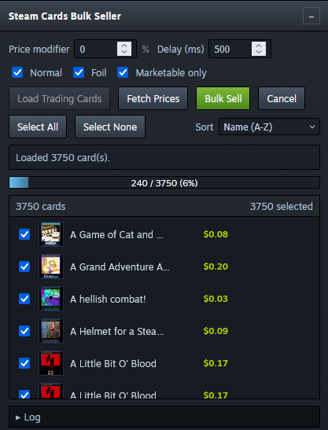

# Steam Cards Bulk Seller

[](https://github.com/f00d4tehg0dz/steam-cards-bulk-seller/actions/workflows/build.yml)
[](https://developer.chrome.com/docs/extensions/mv3/intro/)
[](#install)
[](#install)
[](#install)
[](https://github.com/f00d4tehg0dz/steam-cards-bulk-seller/releases)

A cross-browser extension for bulk-listing Steam trading cards on the Steam Community Market. Verified against inventories of 10,000+ cards. Configurable rate-limited queues keep Steam happy; a persistent price cache keeps repeat runs fast.

---

## Table of contents

- [Features](#features)
- [Screenshots](#screenshots)
- [Install](#install)
  - [Chrome / Edge](#chrome--edge)
  - [Firefox](#firefox)
- [Usage](#usage)
- [Settings](#settings)
- [Build from source](#build-from-source)
- [Contributing](#contributing)
- [License](#license)

## Features

- **Cross-browser MV3** — one codebase runs on Chrome, Edge, and Firefox 121+.
- **Paginated inventory fetch** — handles very large inventories via `start_assetid` / `more_items`.
- **Trading-card filter** — Normal / Foil toggle, marketable-only guard.
- **Bulk price lookup** with persistent cache (`chrome.storage.local`, configurable TTL).
- **Sort by price / name / foil-first** once prices are loaded.
- **Configurable +/- % pricing modifier** — quick-sell, undercut, or list above lowest.
- **Rate-limited queues** with exponential backoff (2s → 32s) on HTTP 429.
- **Exact fee math** — ports Steam's `CalculateFeeAmount` to compute the integer seller-receives value that Steam's endpoint expects.
- **Mobile confirmation preserved** — Steam requires it per listing; this extension queues listings correctly, you approve them on the Steam Mobile app.

## Screenshots



## Install

Prebuilt packages are attached to every [tagged release](https://github.com/f00d4tehg0dz/steam-cards-bulk-seller/releases). Every push to `main` also produces build artifacts on the [Actions tab](https://github.com/f00d4tehg0dz/steam-cards-bulk-seller/actions/workflows/build.yml).

### Chrome / Edge

1. Download `steam-cards-bulk-seller-chrome-vX.Y.Z.zip` (Chrome) or `-edge-vX.Y.Z.zip` (Edge) from [Releases](https://github.com/f00d4tehg0dz/steam-cards-bulk-seller/releases).
2. Unzip to a folder.
3. Open `chrome://extensions` or `edge://extensions`.
4. Enable **Developer mode** (top-right toggle).
5. Click **Load unpacked** and select the unzipped folder.

### Firefox

1. Download `steam-cards-bulk-seller-firefox-vX.Y.Z.xpi` from [Releases](https://github.com/f00d4tehg0dz/steam-cards-bulk-seller/releases).
2. Open `about:debugging#/runtime/this-firefox`.
3. Click **Load Temporary Add-on…** and select the `.xpi` file.

> **Note:** Firefox 121+ required. Temporary add-ons unload when Firefox restarts

## Usage

1. Open [steamcommunity.com/market](https://steamcommunity.com/market/) or your inventory page.
2. The **Steam Cards Bulk Seller** panel appears in the bottom-right corner.
3. Click **Load Trading Cards** — inventory paginates through automatically. Any cached prices load immediately.
4. Click **Fetch Prices** — pulls current lowest-market prices for cards without cached data. Cached entries are skipped.
5. **Sort** the list (Name / Price high→low / Price low→high / Foil first) and uncheck anything you don't want to list.
6. Set your **price modifier** in the panel:
   - `-10` — quick-sell 10% below the current lowest.
   - `0` — match the current lowest.
   - `+5` — undercut by less; slower to sell.
7. Click **Bulk Sell**, confirm the dialog, and let the queue run. Progress + per-card status appear in the list.
8. **On your phone:** Steam Mobile app → **Confirmations** → approve each listing.

## Settings

All persisted via `chrome.storage.sync` (syncs across browsers signed into the same profile). Configurable in the extension popup or, for the most-used ones, directly in the panel.

| Setting | Default | Purpose |
| --- | --- | --- |
| `pricePercent` | `0` | `+/- %` modifier applied to lowest market price |
| `requestDelayMs` | `500` | Delay between `sellitem` POSTs |
| `priceDelayMs` | `350` | Delay between `priceoverview` GETs |
| `maxRetries` | `5` | HTTP 429 retry cap per request |
| `priceCacheTTLMs` | `1800000` (30 min) | Freshness window for cached prices — `0` = never expire |
| `onlyMarketable` | `true` | Skip non-marketable items |
| `cardTypes.normal` | `true` | Include Normal cards |
| `cardTypes.foil` | `true` | Include Foil cards |

The popup also has a **Clear price cache** button to wipe cached prices.

## Build from source

The extension is plain files with no bundler. Clone and load directly:

```bash
git clone https://github.com/f00d4tehg0dz/steam-cards-bulk-seller.git
cd steam-cards-bulk-seller
# Then Load unpacked (Chrome/Edge) or Load Temporary Add-on (Firefox) from this folder.
```

To produce store-ready packages locally (same output as CI):

```bash
mkdir -p dist build/src
cp -r manifest.json background.js content.js content.css injected.js \
      popup.html popup.js popup.css icons build/src/

(cd build/src && zip -qr ../../dist/chrome.zip .)
(cd build/src && zip -qr ../../dist/edge.zip .)
(cd build/src && zip -qr ../../dist/firefox.xpi .)
```

## Contributing

Issues and PRs welcome. 


## License

MIT.
